# steakOS

<p align="center">
  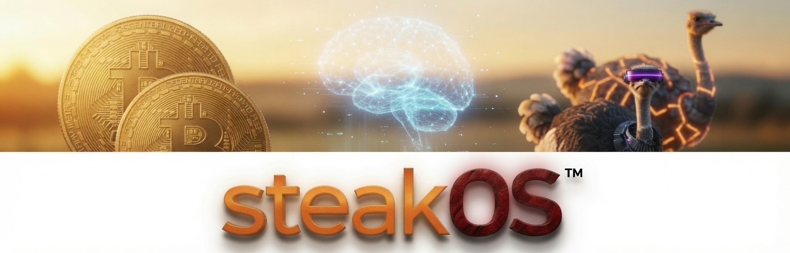
</p>

<p align="center">
  <strong>Run the business. Keep the keys. Bypass inflation.</strong><br/>
  Free open-source software for quotes, orders, stock, invoices, people, and getting paid — on a computer <strong>you</strong> control.<br/>
  <em>No mandatory cloud landlord · Zero-token AI option · Optional Bitcoin · EN / DE / ES</em>
</p>

<p align="center">
  <a href="https://steakos.org">steakos.org</a> ·
  <a href="https://steakos.ai">steakOS.ai</a> (optional help) ·
  <a href="https://github.com/steakOS/steakOS">GitHub</a> ·
  Apache&nbsp;2.0
</p>

<p align="center">
  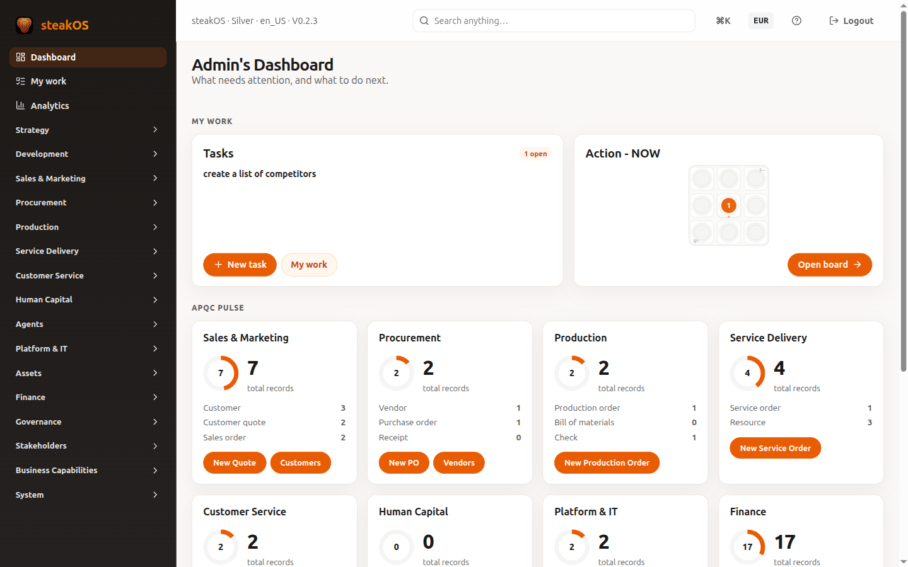
</p>

<p align="center"><sub><strong>Hero:</strong> Action-NOW — what needs you today across the company, after you sign in.</sub></p>

---

## What steakOS is

**steakOS** is free open-source business software for farms, workshops, kitchens, and shops. You install it on a laptop, shop PC, or small server you own. Your customer list, prices, and books stay in **your** database.

| You get | You keep |
|---------|----------|
| Desks for selling, buying, making, delivering, money, and people | Data on hardware you control |
| Guided Help + setup wizard | Passwords and signing keys |
| Optional Bitcoin checkout (self-hosted processor) | No “we hold your coins” middleman |
| Optional AI helpers that **draft**; people **approve** money moves | The right to run with **zero** cloud AI tokens |
| English, German & Spanish screens | Software you can study, change, and share (Apache 2.0) |

> **$0** to use the software — forever free.  
> **0 tokens** required to open the shop. Cloud AI is optional, not a gate.  
> **Your box** — data stays on your computer or your server.

Project home: **[steakos.org](https://steakos.org)**. Standing up a full kitchen can feel overwhelming — **professional help** (install, configuration, integrations, coaching) is available from **[steakOS.ai](https://steakOS.ai)**.

---

## What’s in the name

Everyday speech stays **steakOS**. Behind the letters:

**Sovereign Transactional Enterprise Automation Kernel & Orchestration System**

| | | |
|---|---|---|
| **S** | Sovereign | You own the stack — no mandatory cloud landlord |
| **T** | Transactional | Real records: quotes, orders, money, stock |
| **E** | Enterprise | Whole-business ops (desks), not a single-purpose app |
| **A** | Automation | Workflows; helpers draft, people approve |
| **K** | Kernel | The durable core you run and keep |
| **O** | Orchestration | Coordinates processes, people, helpers, and systems |
| **S** | System | The whole working system — not a slide deck |

---

## Desks (modules)

Think of desks in one building. They share customers, products, and company settings so you do not re-type everything. Start with **Sales + Finance**; add others as the business grows.

| Desk | Plain-language job |
|------|--------------------|
| **Action-NOW** | Daily briefing: what is waiting, overdue, or worth a look |
| **Sales** | Customers, quotes, opportunities, sales orders |
| **Buyers (SCM)** | Vendors, catalogue, purchase orders → receive into stock |
| **Shop floor** | Production orders, quality lot, on-hand stock |
| **Delivery** | Service catalogue, resources, schedule → complete |
| **After-sales** | Inquiries, warranties, claims, returns (RMA) |
| **Finance** | Invoices, payments (bank + optional Bitcoin), treasury, payables, tax |
| **People (HR)** | People files, time, payroll hand-off to finance |
| **Capability** | Projects, quality, change, knowledge |
| **Agents** | Computer co-workers with human-in-the-loop approval |
| **Strategy / Development / Assets / …** | Direction, product projects, physical asset register |
| **Company / Settings / Help** | Profile, users, language, import, in-app Help |

**Size tiers (Bronze → Silver → Gold)** mean starter → growing → large. Starter packs already cover the commercial desks most shops need first. Depth claims match what ships — helpers suggest; people approve money moves.

Most desks open with **tab pills** and a **full-width list**. An **Action** column holds View / Edit / Delete. Many details open in a **pop-up form** so the list stays in view.

---

## Integrations & extras

<p align="center">
  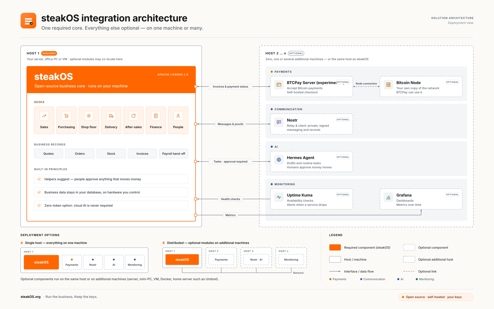
</p>

<p align="center"><sub>One required core on your machine. Payments, messaging, helpers, and monitoring are optional — same host or another box you control.</sub></p>

### Bitcoin (and Lightning)

Connect a **self-hosted Bitcoin payment processor** so invoices can be paid in Bitcoin. steakOS does **not** custody customer coins. On a **DEMO** company, settlement stays fake on purpose so you can practice safely.

### AI helpers (including zero-token)

AI was designed into the desks from the start — not glued on later. Use cloud models when you want them, or run **without any token bill**. Helpers may draft wording or suggest next steps; **anything that moves money still needs a human yes**.

### Nostr

Optional open messaging for notices and audit breadcrumbs. Your database remains the source of truth for balances and documents.

### Help, tour, and setup

- **Help center** — short topics next to the work (EN / DE / ES)  
- **Product tour** (`/tour/`) — guided orientation  
- **Setup wizard** (`/setup`) — company, sites, banking placeholders, size tier  

---

## Screenshots

### Sign in

<p align="center">
  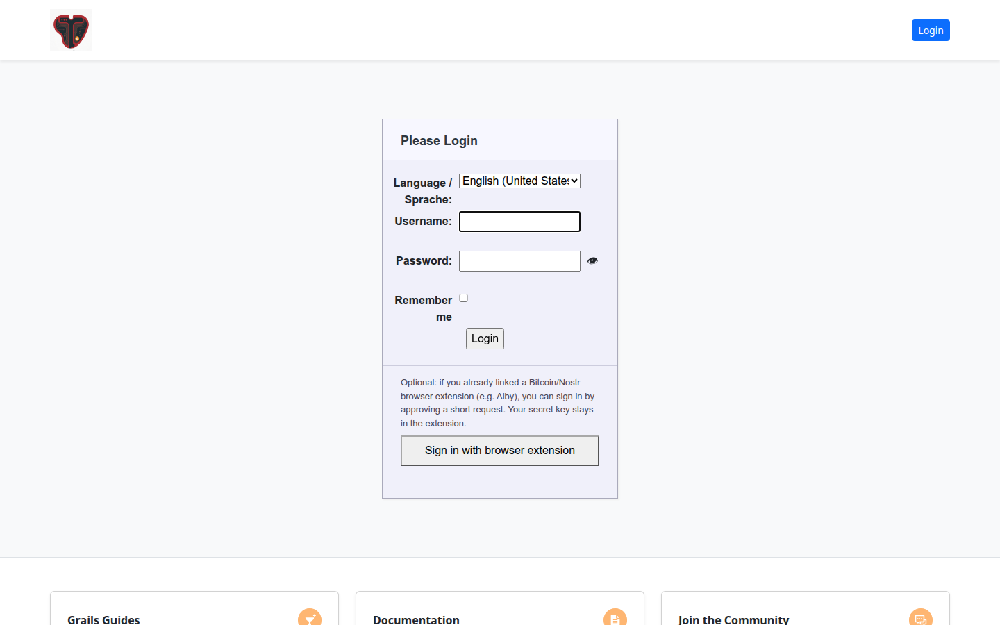
</p>

<p align="center"><sub>The front door — user name, password, and language.</sub></p>

### Company & settings

<p align="center">
  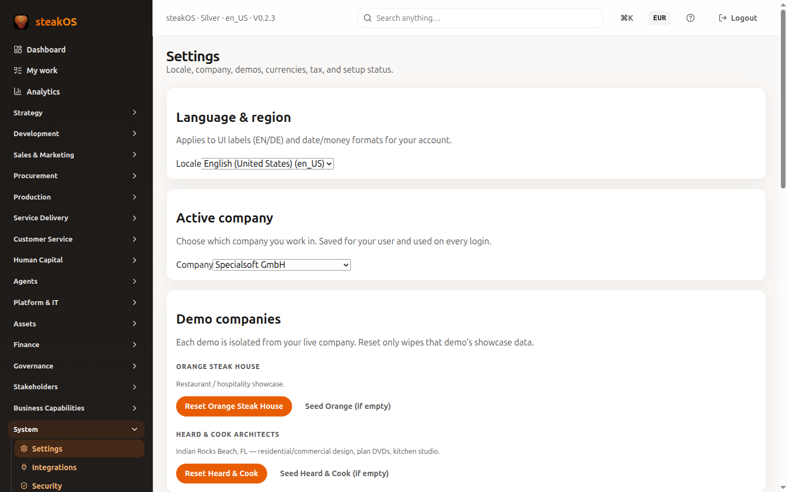
</p>

<p align="center"><sub>Company profile, DEMO vs LIVE posture, and operator preferences.</sub></p>

### Action-NOW

<p align="center">
  
</p>

<p align="center"><sub>Owner overview: decisions waiting, work in motion, shortcuts into desks.</sub></p>

### Help & training

<p align="center">
  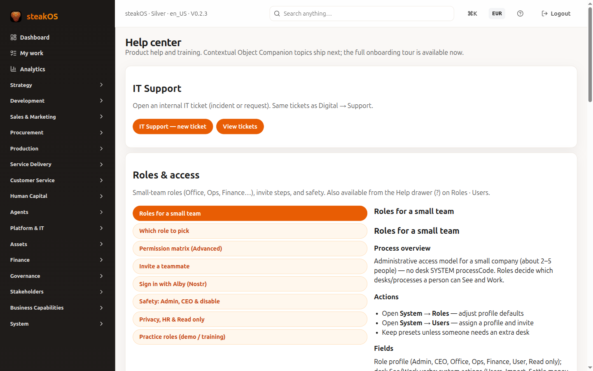
</p>

<p align="center"><sub>In-app Help — learn as you go, without a separate course to start.</sub></p>

<p align="center">
  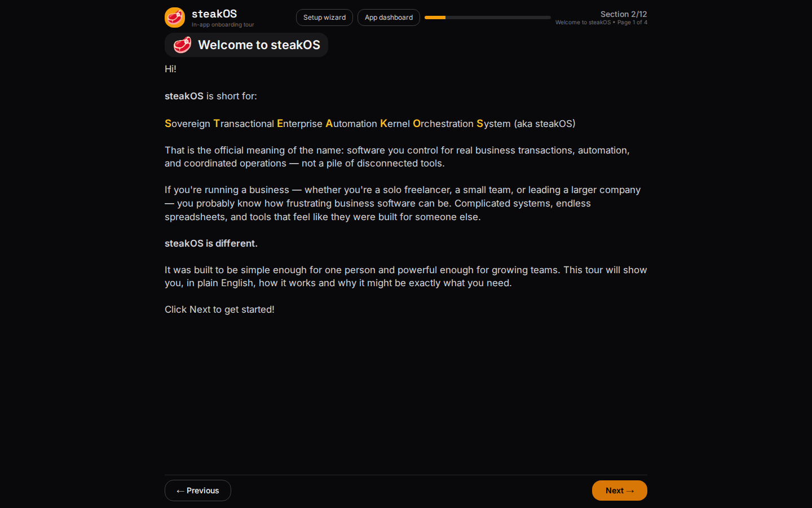
</p>

<p align="center"><sub>Product tour — short lessons before you cook on a new line.</sub></p>

### Setup wizard

<p align="center">
  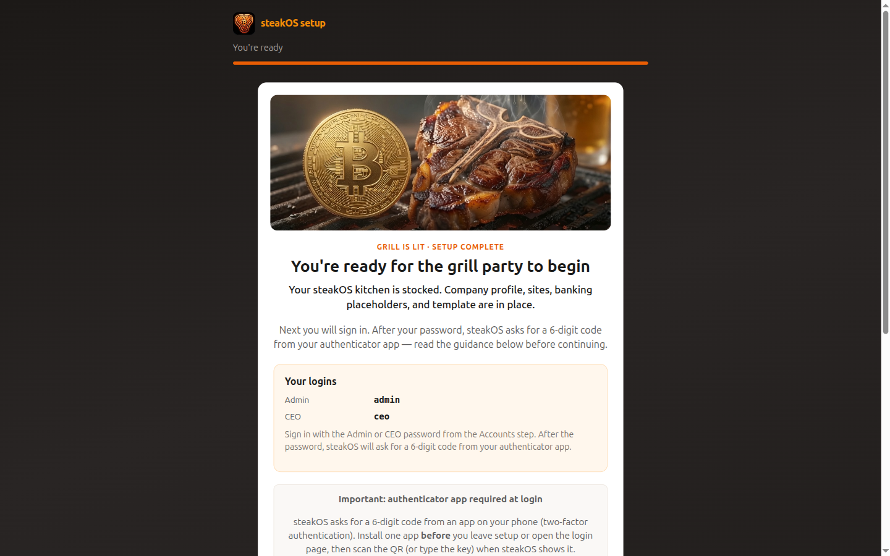
</p>

<p align="center"><sub>Configuration wizard — company, sites, banking placeholders, size tier.</sub></p>

### Sales desk

<p align="center">
  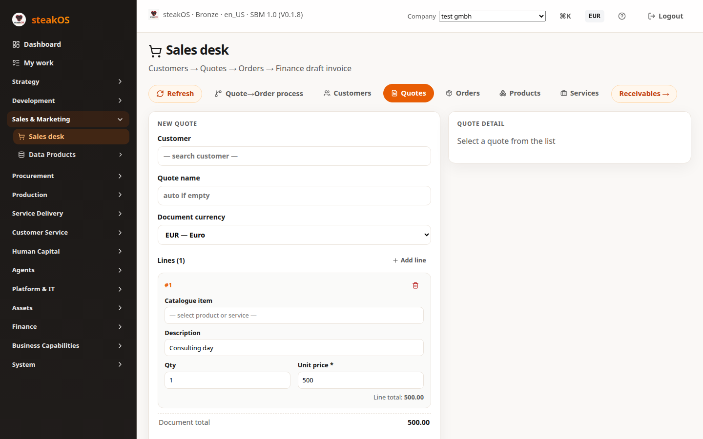
</p>

<p align="center"><sub>Sales — customers, quotes, opportunities, and orders with Action icons.</sub></p>

### Finance desk

<p align="center">
  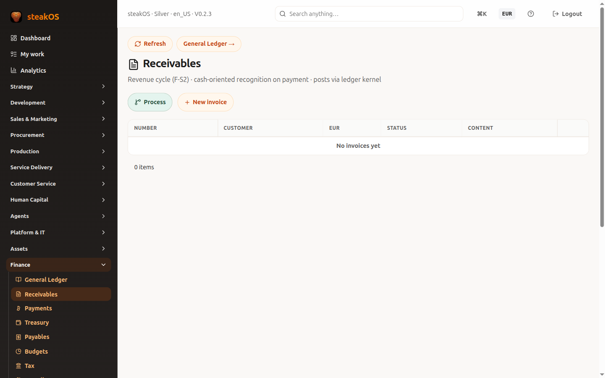
</p>

<p align="center"><sub>Finance — invoices and settlement, including optional Bitcoin rails.</sub></p>

### About

<p align="center">
  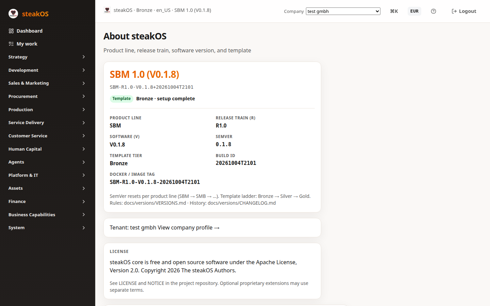
</p>

<p align="center"><sub>About — version stamp and trust links (handy when you ask for help).</sub></p>

### Phone-sized

<p align="center">
  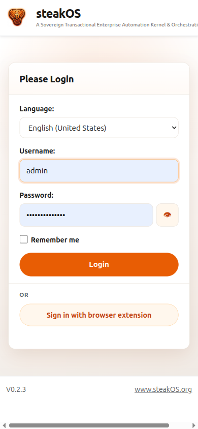
  &nbsp;&nbsp;
  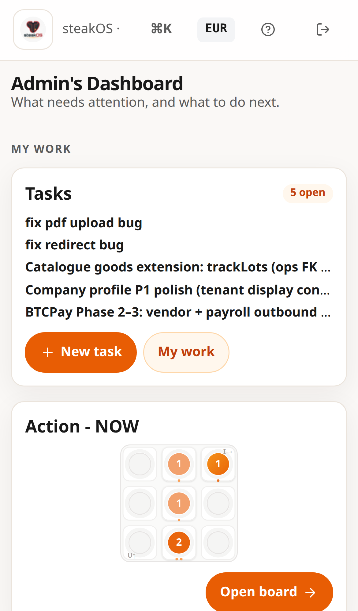
</p>

<p align="center"><sub>Responsive web app — drawer nav and card lists on a phone-sized viewport. Best for status checks and light edits.</sub></p>

---

## A simple first week

1. **Install** (below) or ask a technical friend once.  
2. **Sign in** → open **Settings** / company profile.  
3. Skim **Help** and the **product tour**.  
4. Confirm the **setup wizard**.  
5. On **Sales**, create one customer and one quote.  
6. Accept → confirm order → **Finance** → issue an invoice.  
7. On DEMO, practice fake Bitcoin settlement. Connect real payments on LIVE only when ready.

---

## Get the software

**Public channel:** [github.com/steakOS/steakOS](https://github.com/steakOS/steakOS)  
Project home: **[steakos.org](https://steakos.org)** · optional paid help: **[steakOS.ai](https://steakOS.ai)**

```bash
git clone https://github.com/steakOS/steakOS.git
cd steakOS
```

### One-line install

Installs Java and PostgreSQL if needed, downloads the packaged app from the latest GitHub Release, and starts it.

**Linux / macOS:**

```bash
curl -fsSL https://raw.githubusercontent.com/steakOS/steakOS/main/scripts/install/bootstrap.sh | bash
```

**Windows 11** (PowerShell - must be run as administrator):

```powershell
irm https://raw.githubusercontent.com/steakOS/steakOS/main/scripts/install/bootstrap.ps1 | iex
```

After install, open **http://localhost:9090**, sign in (packaged default first user is documented on [Getting started](https://steakos.org/getting-started.html)), **change the password**, complete the wizard, and use Help.

Offline zip: `./scripts/install/install.sh --offline /path/to/steakOS-….zip`

---

## Hardware that is good enough

| | Recommendation |
|--|----------------|
| **Comfortable** | 16 GB RAM laptop, SSD, stable network for first install |
| **Minimum** | ~8 GB RAM works for evaluation (can feel tight) |
| **Disk** | 20+ GB free to evaluate; 50+ GB SSD for a small team server with backups |
| **Phone / tablet** | Fine for check-ins; heavy setup prefers a laptop |

---

## Operating systems & databases

| Layer | What we test | Notes |
|-------|--------------|-------|
| **Install targets** | Windows 11, macOS, Ubuntu / Linux Mint | Other systems: manual Java 21 + PostgreSQL 16 |
| **Database** | PostgreSQL 14+ (16 preferred) | Filing cabinet we document and smoke-test |
| **Browser** | Current major browsers | Normal responsive web app |

| Piece | Why |
|-------|-----|
| **Java 21** | Kitchen engine |
| **PostgreSQL** | Customers, orders, invoices |
| **Node.js 20+** | **Builders only** (compile screens from source) |

---

## Start it (developer-style)

```bash
# Terminal 1 — kitchen engine
./gradlew bootJar
java -Dgrails.env=development -Xmx768m -jar build/libs/steakOS-*.jar
# http://localhost:6060

# Terminal 2 — screens
cd frontend && npm install && npm run dev
# http://localhost:9001
```

Day to day, use **http://localhost:9001**. It talks to the engine on port 6060 for you.

**Change the default learning password** before real customer data. Never publish passwords into chat, email, or Git.

Packaging: [`deploy/`](deploy/).

---

## Folder map

```text
steakOS/
├── README.md          ← you are here
├── AGENTS.md          ← notes for programmers / AI helpers
├── SECURITY.md        ← how to report a security problem
├── content/           ← brand + screenshots for this README
├── deploy/            ← container packaging
├── grails-app/ · src/ ← server (kitchen engine)
├── frontend/          ← browser screens (+ capture helpers)
├── db/                ← database starter script
├── scripts/           ← install & maintenance helpers
├── demos/             ← filmed example walkthroughs
└── var/               ← local scratch — not for publishing
```

Deep design notes live in a **separate companion project** so this tree stays clean for public mirrors.

---

## Security & trust

Report security issues privately to **[security@steakos.org](mailto:security@steakos.org)** — do not post exploit steps in a public issue. Details: [`SECURITY.md`](SECURITY.md).

Keep secrets **out of Git**. Use environment variables or your machine’s secret store.

steakos.org sets **no tracking cookies** and does not run analytics beacons.

---

## License

Copyright © The steakOS Authors.  
Licensed under the **Apache License, Version 2.0** — see [`LICENSE`](LICENSE).

**[steakos.org](https://steakos.org)** — free to use forever.  
**[steakOS.ai](https://steakOS.ai)** — optional human help when you want a seasoned crew in the kitchen.

---

<p align="center">
  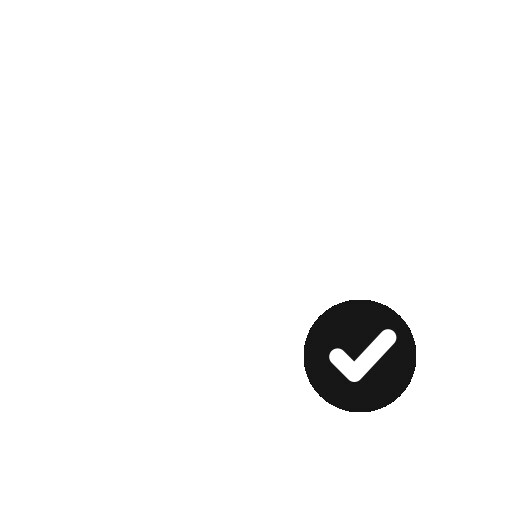<br/>
  <sub>Built for founders who keep the keys — and still want a calm Monday morning.</sub>
</p>
